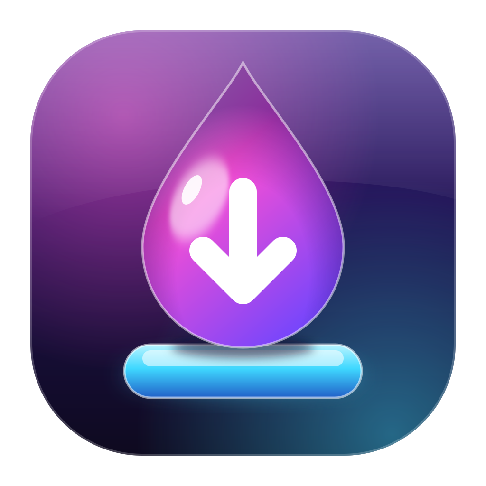
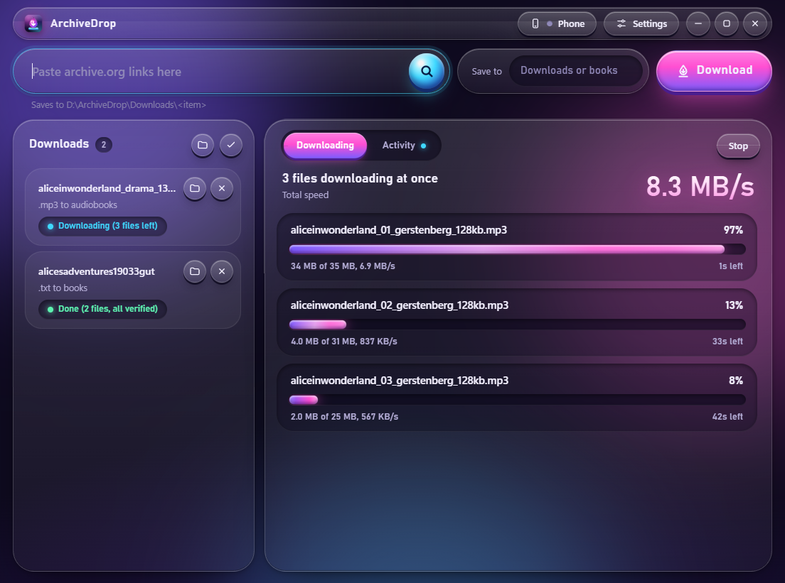
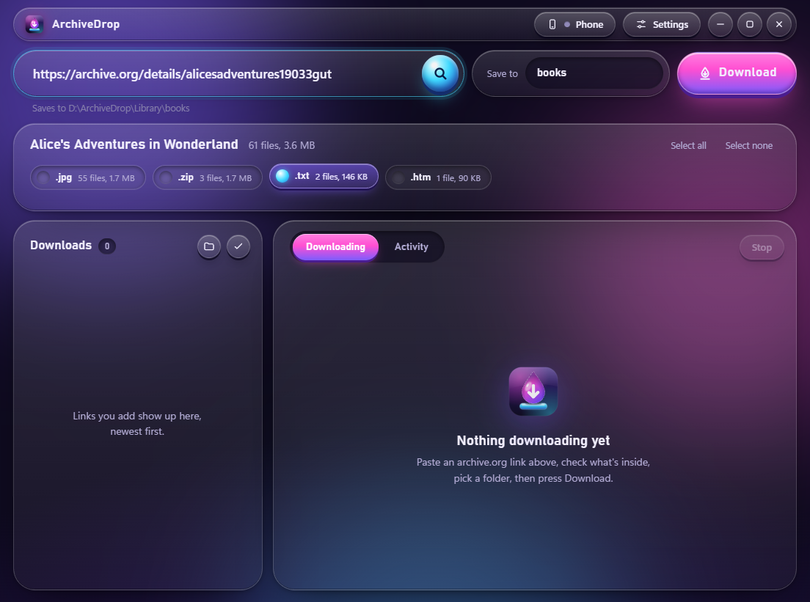
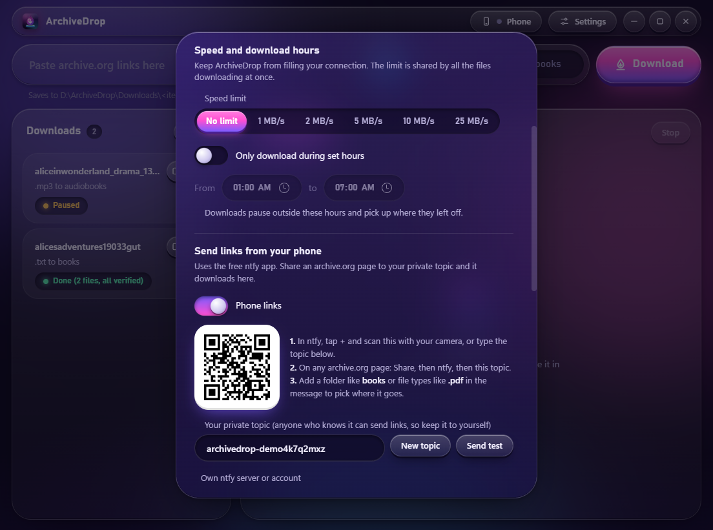

<p align="center">
  
</p>

<h1 align="center">ArchiveDrop</h1>

<p align="center">
  Paste an archive.org link, pick the files you want, and they land in the right folder.<br>
  A free Windows app for bulk downloading from the Internet Archive: several files at once, resumable, every file checked.
</p>

<p align="center">
  <a href="https://github.com/ikolander951/archivedrop/releases/latest/download/ArchiveDrop-Setup.exe"><b>Download for Windows</b></a>
  &nbsp;·&nbsp;
  <a href="https://ikolander951.github.io/archivedrop/">Website</a>
  &nbsp;·&nbsp;
  <a href="https://github.com/ikolander951/archivedrop/releases">All releases</a>
</p>

<p align="center">
  
</p>

## Why use it

archive.org's own download links are fine for a file or two. For bigger jobs you either click files one at a time or download a whole format as a single zip, and an item's torrent can be missing files that were added or changed after it was made. The official `ia` command-line tool handles bulk downloads well if you're comfortable in a terminal. ArchiveDrop uses the same `internetarchive` library behind a normal window.

It's built for jobs like a full audiobook or radio series, a shelf of scanned manuals or magazines, an old software collection, or a set of public-domain films.

## What it does

- **Check before you download.** Paste a link and ArchiveDrop reads the item: title, file count, total size, and every file type with its own count and size. Untick the types you don't want.
- **Lands in the right folder.** Pick a destination folder from a dropdown, or leave it blank for Downloads. Typos get a "did you mean" prompt instead of a stray folder.
- **Fast.** Downloads 1–6 files at once across all your queued links, with a live progress bar, speed and time left for each file.
- **Paste a whole list.** Drop many links into the link bar at once and they're queued together with the same folder and file types.
- **Send links from your phone.** Share any archive.org page to a private [ntfy](https://ntfy.sh) topic and it starts downloading on your PC. You get "Added" and "Downloaded" notifications back. Add a folder name like `books` or file types like `.pdf` in the message, or send them right after the link.
- **Resumes, never re-downloads.** Interrupted downloads continue where they stopped; files you already have are skipped.
- **Checks every file.** Each download is compared with the MD5 checksum the archive publishes. A file that doesn't match is deleted and downloaded again, so a finished job means intact files.
- **Signs in when an item needs it.** Some items are only available to archive.org accounts. Sign in once under Settings; your password goes straight to archive.org and isn't saved.
- **Speed limit and download hours.** Cap the total speed so it doesn't hog your connection, and optionally only download overnight. Downloads pause outside those hours and pick up where they left off.
- **Updates itself.** A one-tap **Update** button appears when a new release is published here.
- **Keeps working in the background.** An optional scheduled task checks your list every 15 minutes, even with the window closed.
- **Skips the clutter.** Archive-generated extras (thumbnails, metadata, torrents) are left out by default.

<p align="center">
  
  
</p>

## Install

1. Download **[ArchiveDrop-Setup.exe](https://github.com/ikolander951/archivedrop/releases/latest/download/ArchiveDrop-Setup.exe)** (about 15 MB).
2. Run it. No admin rights and no Python needed. It installs for your Windows user only.
3. If Windows shows "Windows protected your PC", click **More info → Run anyway**. The installer isn't code-signed yet.

**No installer?** Get **[ArchiveDrop-Portable.zip](https://github.com/ikolander951/archivedrop/releases/latest/download/ArchiveDrop-Portable.zip)** instead, unzip it anywhere (a USB stick works) and run `ArchiveDrop.exe`. It keeps its settings and queue in a `data` folder beside the exe. To update it, unzip the new version over the old folder.

Requires Windows 10 or 11 (64-bit) with the Microsoft Edge WebView2 runtime, which Windows 11 already includes.

**Updates are built in.** When a new release is out, an **Update** button appears in the title bar: tap it, check what's new, and **Install update**. ArchiveDrop downloads the installer from this repo's releases, checks it against the published size, upgrades in place and reopens. Settings, queue, history and running downloads carry over. You can turn automatic checks off under **Settings → Updates**. Uninstall from **Settings → Apps** like any other app.

## Sending links from your phone

1. In ArchiveDrop, open **Settings** (or click **Phone** in the title bar) and turn on **Phone links**. It creates a private topic and shows a QR code.
2. Install the free **ntfy** app on your phone, tap **+**, and scan the code (or type the topic).
3. On any archive.org page: **Share → ntfy → your topic**. Optionally type a folder name or file types in the message.

Links arrive within a few seconds while ArchiveDrop is open, or within 15 minutes from the background task. Anyone who knows your topic name can send links, so keep it private and use **New topic** if it ever leaks.

## Build from source

Requires Windows, Python 3.15+, [PyInstaller](https://pyinstaller.org) and [Inno Setup 7](https://jrsoftware.org/isinfo.php). `build.ps1` upgrades every dependency to its latest release before each build.

```powershell
pip install --user internetarchive pywebview qrcode pyinstaller
powershell -ExecutionPolicy Bypass -File build.ps1   # -> out\ArchiveDrop-Setup.exe
```

To run without building: `python archivedrop.pyw` (window) or `python archivedrop.pyw --background` (process the list once, no window).

| File | What it is |
| --- | --- |
| `archivedrop.pyw` | Desktop app: window, download scheduler, settings, phone inbox wiring |
| `ia_autodl.py` | Download engine: link parsing, file filtering, resumable parallel downloads, queue and watch lists |
| `ntfy_inbox.py` | Phone links over ntfy: polling, message parsing, replies |
| `ui/index.html` | The interface (HTML/CSS/JS rendered by WebView2) |
| `build.ps1`, `installer.iss`, `task.ps1` | Build script, Inno Setup installer, background-task registration |

## Use it responsibly

ArchiveDrop downloads whatever the Internet Archive serves for the links you give it. Only download material you have the right to download, and respect each item's license and the Internet Archive's [terms of use](https://archive.org/about/terms.php). ArchiveDrop is an independent project and isn't affiliated with the Internet Archive.

## License

[MIT](LICENSE) © 2026 John Biswas
